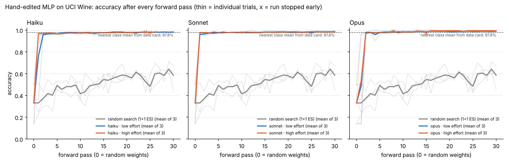

# weight-space-programming

A small, reproducible experiment: can an LLM improve a neural network **only by
editing its weights by hand and running forward passes**, with no training?



## Setup

| | |
|---|---|
| Data | [UCI Wine](https://archive.ics.uci.edu/dataset/109/wine): 178 real wines, 13 chemical measurements, 3 cultivars. Committed as `data/wine.csv`, with its SHA-256 checked on every load. Features are z-score standardized. |
| Model | MLP `13 → 10 ReLU → 10 ReLU → 3 softmax`: two hidden layers of 10 perceptrons each (283 parameters). Pure numpy. |
| Baseline | Pass 0 of every run is He-normal random weights (seed = trial index, so trial *k* starts from the same weights for every model). |
| Budget | 30 forward passes per run, enforced by the CLI. |
| Metric | Accuracy and cross-entropy on the **entire** dataset after every pass. |
| LLM arms | Haiku, Sonnet and Opus × effort `low` / `high` × 3 trials each = 18 runs. Each agent got the same prompt: [`prompts/agent_prompt.md`](prompts/agent_prompt.md), rendered per run as `runs/<config>/trial<k>/prompt.md`. |
| Non-LLM arm | `random-search`: a (1+1) evolution strategy (Gaussian perturbation of all weights, kept if loss improves), with the same 30-pass budget. |

The agent loop: read `weights.json` → edit it by hand → `python -m wsp forward --run <dir>` → read the accuracy, loss, confusion matrix and dead-ReLU count → repeat.
Agents were told this command is the only one they may run, with no scripts, gradients or optimizers, and that they may read only their own run folder.

## Results

`results/summary.md` (accuracy on all 178 samples; final = the last logged pass):

| config | trials | pass 0 acc | final acc (mean) | best acc (mean) | final accs | passes used |
|---|---|---|---|---|---|---|
| random-search | 3 | 0.331 | 0.586 | 0.661 | 0.635, 0.669, 0.455 | 30, 30, 30 |
| haiku-low | 3 | 0.331 | 0.983 | 0.983 | 0.983, 0.983, 0.983 | 30, 30, 30 |
| haiku-high | 3 | 0.331 | 0.981 | 0.983 | 0.983, 0.978, 0.983 | 26, 25, 24 † |
| sonnet-low | 3 | 0.331 | 0.987 | 0.987 | 0.989, 0.994, 0.978 | 30, 30, 30 |
| sonnet-high | 3 | 0.331 | 0.985 | 0.987 | 0.983, 0.983, 0.989 | 30, 30, 30 |
| opus-low | 3 | 0.331 | 0.991 | 0.991 | 1.000, 0.989, 0.983 | 30, 30, 30 |
| opus-high | 3 | 0.331 | 0.985 | 0.991 | 0.989, 0.972, 0.994 | 8, 15, 30 † |

† These runs were stopped by the user before they used all 30 passes.

Data for any other chart is in `results/all_passes.csv`, with one row per (config, trial, pass) and a `weights_changed` column counting how many of the 283 parameters changed since the previous pass. Loss curves are in `results/loss.png`.

### How to read this (important caveat)

Every LLM run used the same trick: **ignore the random weights and write a classifier from scratch.**
The data card in the prompt gives each class's average value for every feature. The agents copied those averages into 3 hidden1 neurons as one detector per cultivar, passed the scores through hidden2 unchanged, read them off at the output, and zeroed the remaining units.
Predicting the nearest class average from the data card alone already scores **97.8%** (the dashed line in the chart).
So the jump from about 33% to about 97% in 1–2 passes comes from the summary statistics in the prompt. It is not a search through weight space.
The remaining 1–2 points come from hand-tuning against feedback on the same 178 samples. There is no held-out set, so treat that part as optimizing directly on the evaluation data.
For comparison, the blind random search reaches about 59% under the same budget, and a trained logistic regression scores 100% on its own training data.

Differences between models and effort levels here are within one or two samples, too small to rank them.

## Protocol deviations (full disclosure)

- **Nudges.** Sonnet-low trials 0, 1, 2 and Haiku-low trial 2 stopped early, after 2–17 passes, at 96–98%. Each got one follow-up message: "the protocol asks you to use all 30 passes… keep going with the same rules." No other run got a nudge.
- **Stopped runs.** Haiku-high (all 3 trials) and Opus-high trials 0–1 were stopped by the user, so their logs are shorter. The chart marks where each stopped with an ×.
- **Rule slips the agents reported themselves.**
  - Opus-low trial 2 ran one no-op shell command (`cd … && false`) and created an empty scratch file.
  - Opus-low trial 1 also created a stray note file.
  - Both files were deleted. Neither affected any pass.
  - Haiku-low trial 1 made one documentation-tool call.
- **Not re-evaluated.** Sonnet-high trial 0 reverted `weights.json` after its 30th pass without evaluating it again. The logged pass 30 (98.3%) is what counts.
- **Self-reports only.** These checks rest on what the agents said they did. The CLI cannot stop a determined agent from running other code. The `weights_changed` column and the per-pass snapshots let you audit what each edit actually changed.
- **Effort setting.** Effort was passed as the subagent effort setting. Whether every model honors it at every level was not verified.

## Reproduce

```bash
pip install -r requirements.txt   # numpy, matplotlib (scikit-learn only for scripts/fetch_data.py)

python -m wsp describe                                  # the data card shown to the agents
python -m wsp replay --run runs/opus-low/trial0         # re-run every logged pass from its saved weights
python -m wsp report                                    # rebuild results/ from all runs/*/trial*/history

# fresh runs
python -m wsp random-search --run runs/random-search/trial0 --seed 0   # fully deterministic
python -m wsp init --run runs/my-model/trial0 --seed 0 && python scripts/render_prompt.py runs/my-model/trial0
#   ...give runs/my-model/trial0/prompt.md to any LLM agent...
```

Everything except the LLM's choices is deterministic.
Each pass's exact weights are saved in `runs/<config>/trial<k>/history/pass_XXX.json`. `replay` and `report` recompute every metric from those snapshots and do not trust the logs.
All 21 runs replay with matching numbers.

## Layout

```
data/wine.csv            dataset (exported once by scripts/fetch_data.py)
wsp/model.py             MLP, init, forward pass, readable JSON format
wsp/cli.py               init / forward (quota) / describe / random-search / replay / report
wsp/report.py            aggregation + charts
prompts/agent_prompt.md  the prompt template given to every LLM agent
runs/<config>/trial<k>/  prompt.md, weights.json (final), log.csv, history/pass_XXX.json
results/                 all_passes.csv, summary.md, accuracy.png, loss.png
```

## Next experiment worth running

Remove the class averages from the data card, so agents see feature names only. Also split off a held-out test set, so tuning against the score can't inflate the result.
That would test actual reasoning about weights instead of copying a nearest-class-average classifier.
