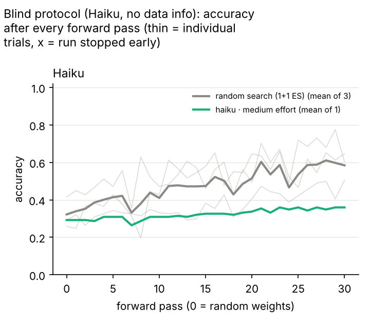
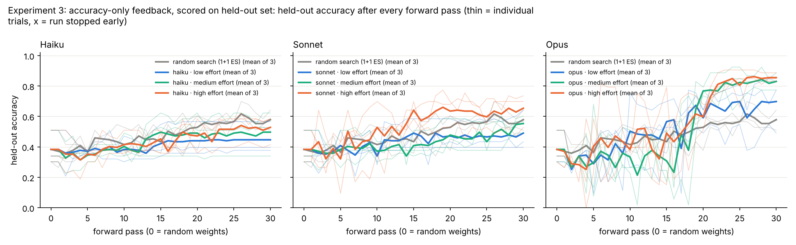
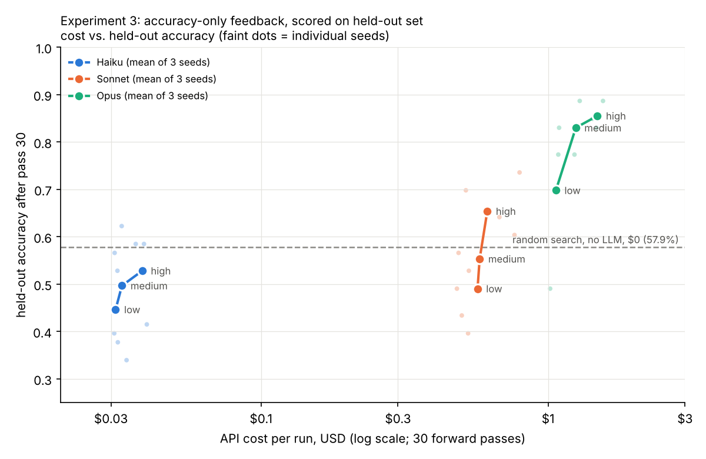

# weight-space-programming

A small, reproducible experiment: can an LLM improve a neural network **only by
editing its weights by hand and running forward passes**, with no training?


## Setup

| | |
|---|---|
| Data | [UCI Wine](https://archive.ics.uci.edu/dataset/109/wine): 178 real wines, 13 chemical measurements, 3 cultivars. Committed as `data/wine.csv`, with its SHA-256 checked on every load. Features are z-score standardized. |
| Model | MLP `13 → 10 ReLU → 10 ReLU → 3 softmax`: two hidden layers of 10 perceptrons each (283 parameters). Pure numpy. |
| Baseline | Pass 0 of every run is He-normal random weights (seed = trial index, so trial *k* starts from the same weights for every model). |
| Budget | 30 forward passes per run, enforced by the CLI. |
| Metric | Accuracy and cross-entropy on the **entire** dataset after every pass. |
| LLM arms | Haiku, Sonnet and Opus × effort `low` / `high` × 3 trials each = 18 runs. Each agent got the same prompt: [`prompts/agent_prompt.md`](prompts/agent_prompt.md), rendered per run as `runs/<config>/trial<k>/prompt.md`. |
| Non-LLM arm | `random-search`: a (1+1) evolution strategy (Gaussian perturbation of all weights, kept if loss improves), with the same 30-pass budget. |

The agent loop: read `weights.json` → edit it by hand → `python -m wsp forward --run <dir>` → read the accuracy, loss, confusion matrix and dead-ReLU count → repeat.
Agents were told this command is the only one they may run, with no scripts, gradients or optimizers, and that they may read only their own run folder.

## Results

`results/summary.md` (accuracy on all 178 samples; final = the last logged pass):

| config | trials | pass 0 acc | final acc (mean) | best acc (mean) | final accs | passes used |
|---|---|---|---|---|---|---|
| random-search | 3 | 0.331 | 0.586 | 0.661 | 0.635, 0.669, 0.455 | 30, 30, 30 |
| haiku-low | 3 | 0.331 | 0.983 | 0.983 | 0.983, 0.983, 0.983 | 30, 30, 30 |
| haiku-high | 3 | 0.331 | 0.981 | 0.983 | 0.983, 0.978, 0.983 | 26, 25, 24 † |
| sonnet-low | 3 | 0.331 | 0.987 | 0.987 | 0.989, 0.994, 0.978 | 30, 30, 30 |
| sonnet-high | 3 | 0.331 | 0.985 | 0.987 | 0.983, 0.983, 0.989 | 30, 30, 30 |
| opus-low | 3 | 0.331 | 0.991 | 0.991 | 1.000, 0.989, 0.983 | 30, 30, 30 |
| opus-high | 3 | 0.331 | 0.985 | 0.991 | 0.989, 0.972, 0.994 | 8, 15, 30 † |

† These runs were stopped by the user before they used all 30 passes.

Data for any other chart is in `results/all_passes.csv`, with one row per (config, trial, pass) and a `weights_changed` column counting how many of the 283 parameters changed since the previous pass. Loss curves are in `results/loss.png`.

### How to read this (important caveat)

Every LLM run used the same trick: **ignore the random weights and write a classifier from scratch.**
The data card in the prompt gives each class's average value for every feature. The agents copied those averages into 3 hidden1 neurons as one detector per cultivar, passed the scores through hidden2 unchanged, read them off at the output, and zeroed the remaining units.
Predicting the nearest class average from the data card alone already scores **97.8%** (the dashed line in the chart).
So the jump from about 33% to about 97% in 1–2 passes comes from the summary statistics in the prompt. It is not a search through weight space.
The remaining 1–2 points come from hand-tuning against feedback on the same 178 samples. There is no held-out set, so treat that part as optimizing directly on the evaluation data.
For comparison, the blind random search reaches about 59% under the same budget, and a trained logistic regression scores 100% on its own training data.

Differences between models and effort levels here are within one or two samples, too small to rank them.

## Protocol deviations (full disclosure)

- **Nudges.** Sonnet-low trials 0, 1, 2 and Haiku-low trial 2 stopped early, after 2–17 passes, at 96–98%. Each got one follow-up message: "the protocol asks you to use all 30 passes… keep going with the same rules." No other run got a nudge.
- **Stopped runs.** Haiku-high (all 3 trials) and Opus-high trials 0–1 were stopped by the user, so their logs are shorter. The chart marks where each stopped with an ×.
- **Rule slips the agents reported themselves.**
  - Opus-low trial 2 ran one no-op shell command (`cd … && false`) and created an empty scratch file.
  - Opus-low trial 1 also created a stray note file.
  - Both files were deleted. Neither affected any pass.
  - Haiku-low trial 1 made one documentation-tool call.
- **Not re-evaluated.** Sonnet-high trial 0 reverted `weights.json` after its 30th pass without evaluating it again. The logged pass 30 (98.3%) is what counts.
- **Self-reports only.** These checks rest on what the agents said they did. The CLI cannot stop a determined agent from running other code. The `weights_changed` column and the per-pass snapshots let you audit what each edit actually changed.
- **Effort setting.** Effort was passed as the subagent effort setting. Whether every model honors it at every level was not verified.

## Reproduce

```bash
pip install -r requirements.txt   # numpy, matplotlib (scikit-learn only for scripts/fetch_data.py)

python -m wsp describe                                  # the data card shown to the agents
python -m wsp replay --run runs/opus-low/trial0         # re-run every logged pass from its saved weights
python -m wsp report                                    # rebuild results/ from all runs/*/trial*/history
python -m wsp report --runs runs-blind --out results-blind --models haiku,sonnet,opus --title "Blind protocol (no data info, accuracy+loss feedback only)"
python -m wsp report --runs runs-holdout --out results-holdout --models haiku,sonnet,opus --title "Experiment 3: accuracy-only feedback, scored on held-out set"
python -m wsp cost --results results-holdout --title "Experiment 3: accuracy-only feedback, scored on held-out set"   # needs results-holdout/usage.csv

# fresh runs
python -m wsp random-search --run runs/random-search/trial0 --seed 0   # fully deterministic
python -m wsp init --run runs/my-model/trial0 --seed 0 && python scripts/render_prompt.py runs/my-model/trial0
#   ...give runs/my-model/trial0/prompt.md to any LLM agent...
```

Everything except the LLM's choices is deterministic.
Each pass's exact weights are saved in `runs/<config>/trial<k>/history/pass_XXX.json`. `replay` and `report` recompute every metric from those snapshots and do not trust the logs.
All 21 runs replay with matching numbers.

## Layout

```
data/wine.csv            dataset (exported once by scripts/fetch_data.py)
wsp/model.py             MLP, init, forward pass, readable JSON format
wsp/cli.py               init / forward (quota) / describe / random-search / replay / report
wsp/report.py            aggregation + charts
prompts/agent_prompt.md  the prompt template given to every LLM agent
runs/<config>/trial<k>/  prompt.md, weights.json (final), log.csv, history/pass_XXX.json
results/                 all_passes.csv, summary.md, accuracy.png, loss.png
```

## Experiment 2: blind protocol (no data leakage)

This run removes everything the agent could use to reason about the data. The prompt is [`prompts/agent_prompt_blind.md`](prompts/agent_prompt_blind.md), and runs are created with `python -m wsp init --blind ...`. Results are in `runs-blind/` and `results-blind/`.

- **No data information.** There is no dataset name, no feature names, no class meanings and no statistics. The agent sees only the architecture (13 → 10 → 10 → 3), its own `weights.json`, and each forward pass.
- **Minimal feedback.** `forward` prints only accuracy and mean cross-entropy loss: no confusion matrix and no activation statistics. Activation stats are also left out of the run's own `log.csv`, which the agent could read.
- **Permuted inputs and labels.** The input columns and class labels are shuffled with a fixed seed (`wsp/data.py`, `BLIND_SEED`). An agent that guesses "13 features, 3 classes = Wine" still can't map remembered facts onto the weights.
- **Checked, not trusted.** `scripts/audit_transcript.py` scans the agent's full tool-call transcript and flags anything other than reading its prompt and weights, editing `weights.json`, and the exact forward command. It writes `RUN/audit.txt`.
- **Baseline.** The random-search baseline is re-run on the same permuted data, from the same seeds.



All 27 runs (3 models × 3 effort levels × 3 seeds) used the full 30 passes. Accuracy is on all 178 samples, at the last logged pass, as a mean over the 3 seeds:

| | low | medium | high |
|---|---|---|---|
| **Haiku** | 45.9% | 43.1% | 54.5% |
| **Sonnet** | 51.3% | 57.9% | 68.4% |
| **Opus** | 74.3% | 84.1% | **86.0%** |
| random search (no LLM) | 58.4% | | |

Every run started at a mean of 32.2% (seeds 0, 1, 2 give 29.2%, 41.6% and 25.8%). The most common class is 39.9%. The per-trial numbers are in `results-blind/summary.md`, and every pass is in `results-blind/all_passes.csv`.

**Two strategies, and they explain almost all of the spread.** `results-blind/summary.md` counts how many weights each run changed between pass 0 and its last pass:

- **Tweak the output layer (21 runs, mean 55.2%, range 36–74%).** These runs left the hidden layers random. They halved, flipped, reordered or zeroed output rows and columns, and nudged biases, one change per pass, keeping a change if it helped. This is a hand-run version of random search, and it does about as well: every Haiku run used this strategy, and none beat random search on average.
- **Rebuild the network (6 runs, mean 89.4%, range 77–98%).** These runs rewrote every hidden weight, wiring the 10-10 network into an exact linear model by passing chosen inputs through relu(x) and relu(−x) pairs. Then they used forward passes as experiments:
  - forcing one class to measure how common each class is;
  - sending one input through at a time to see whether it pushes toward class 0 or class 2;
  - discovering that one class sits "in the middle" of a direction.

  The runs were Opus-low seed 0 (90.4%), Opus-medium seeds 0 and 1 (86.5%, 91.6%), Opus-high seeds 0 and 1 (97.8%, 93.3%), and Sonnet-high seed 0 (77.0%).

**A caveat on the best run (Opus-high seed 0, 97.8%).** It never saw the data, but it used the loss as a measuring instrument. Its probe passes send one input straight to the logits at a tiny scale (0.1). At that scale the change in loss away from ln 3 is close to a weighted difference of that input's class averages. From those readings it worked out the class averages by hand and wrote a nearest-class-average classifier in pass 29, reaching the same 97.8% the leaky experiment 1 got from the data card. No written rule forbids this: it ran only the forward command and did no gradient code. But it is effectively a hand-computed gradient (a finite-difference probe) of the data statistics. The other rebuilders did something milder: they hill-climbed the weights of a linear model they had built, using the loss.

**Audit.** All 27 transcripts were audited (`runs-blind/*/trial*/audit.txt`) and all 27 runs replay exactly from their weight snapshots. No agent read the data, the source, other runs or any other file. There were four harmless slips:
- one edit to a mistyped path, which failed;
- two no-op shell commands (`python - 2>/dev/null; true` and `cd <run> && true`);
- one forward pass whose output the agent piped to `head -0`, wasting that pass on unchanged weights.

### Audit of experiment 1

Every experiment-1 transcript was also audited (`runs/*/trial*/audit.txt`). No agent read the dataset, the source code or another run's files. The only flags are:
- the slips listed above;
- one documentation-tool call by Haiku-low trial 1;
- two edits by Sonnet-high that targeted a mistyped path and failed harmlessly.

## Experiment 3: accuracy-only feedback, scored on a held-out set

Same blind setup as experiment 2: no data information, and permuted inputs and labels. Two things are tightened. The prompt is [`prompts/agent_prompt_holdout.md`](prompts/agent_prompt_holdout.md), and runs are created with `python -m wsp init --holdout ...`. Results are in `runs-holdout/` and `results-holdout/`.

- **Held-out split.** A fixed, stratified 70/30 split (`wsp/data.py`, `SPLIT_SEED`): 125 feedback wines and 53 held-out wines. Inputs are standardized with feedback-set statistics only.
- **Accuracy-only feedback.** `forward` prints only accuracy on the 125 feedback wines: no loss. Accuracy moves in steps of 1/125, which blocks the loss-based measuring trick seen in experiment 2. The run's `log.csv` likewise holds feedback accuracy only.
- **Scored only on held-out wines.** The score is held-out accuracy of the weights evaluated on pass 30. It is computed afterwards from the weight snapshots by `python -m wsp report` and is never written where the agent can read it. The agent was told it would be scored on unseen data.
- **Baseline.** Random search gets the same signal: it keeps a perturbation if feedback accuracy is equal or higher.



Held-out accuracy at pass 30, mean of 3 seeds. The start is 38.4%, and the most common class is 39.6% of the held-out wines:

| | low | medium | high |
|---|---|---|---|
| **Haiku** | 44.7% | 49.7% | 52.8% |
| **Sonnet** | 49.1% | 55.3% | 65.4% |
| **Opus** | 69.8% | 83.0% | **85.5%** |
| random search (no LLM) | 57.9% | | |

Per-trial values are in `results-holdout/summary.md`. Every pass is in `results-holdout/all_passes.csv`, which records both held-out and feedback accuracy. `results-holdout/feedback_accuracy.png` shows what the agents saw.

**Findings**

- **The ranking survives the stricter test.** Opus beats random search at every effort level, Sonnet only at high effort, and Haiku never does. More effort helps all three models.
- **Little overfitting.** The gap between feedback and held-out accuracy is small, averaging +4 to +6 points for Opus and within ±3 points for the others. The hand-built classifiers are simple: one or two linear scores over a few inputs.
- **The same two strategies.** Nine runs rewrote the whole network: eight of the nine Opus runs (all but Opus-low seed 2) and Sonnet-high seed 0. These averaged **82.2% held-out** (73.6–88.7%). The other 18 runs kept the random hidden layers and flipped or nudged weights, averaging **51.5%** (best 69.8%).
- **How the rebuilders worked with accuracy alone.** They spent 2–3 passes forcing one class to read off how common each class is. They then rewired the network to test single inputs ("high x_i → class 0, low → class 2"), using the accuracy of each probe as a signal. Finally they combined the useful inputs into one or two hand-weighted scores, with the middle class as a band between thresholds.

  This is still learning from the feedback set through forward passes, but it is far coarser than reading class averages off the loss. And the held-out score shows it generalizes.

**Audit.** All 27 transcripts were audited (`runs-holdout/*/trial*/audit.txt`) and all runs replay exactly. No agent read the data, the source, other runs or the scores. Six minor flags:
- Opus-low seed 2 made one bias edit with `sed` instead of the Edit tool. It was a hand-chosen value.
- Opus-medium seed 1 ran a no-op `cp weights.json /dev/null`.
- Sonnet-medium seed 0 mistyped the forward command once. It errored and used no pass.
- Haiku-high seed 0 made one documentation lookup.
- Haiku-low seed 2 made a failed `send_message` call with placeholder arguments.
- Haiku-high seed 2's final report used a differently named tool, which the auditor now accepts.

## Cost vs. performance



Cost is the API cost of one 30-pass agent run, computed from the token usage in each agent's transcript.
- Token counts per run are in `results-*/usage.csv`, extracted with `scripts/extract_usage.py`.
- Pricing uses `python -m wsp cost --results results-holdout`; prices are in `wsp/cost.py`.

Pricing assumptions:
- First-party list prices as of November 2026, in USD per million tokens: Haiku 5.5 $0.10 in / $0.50 out, Sonnet 5.5 $2 / $10, Opus 5.5 $4 / $20.
- Cache writes are billed at 1.25× the input price.
- Cache reads are $0.20 for Opus and $0.10 for Sonnet. The Haiku cache-read price is assumed to be $0.01, the same 0.1× ratio.
- Most input tokens are cache reads, because each pass re-sends the conversation.
- Every request was served by the requested model (no fallbacks), and no Haiku prompt exceeded 100K tokens.

Experiment 3, mean of 3 seeds:

| model | effort | cost per run | held-out accuracy |
|---|---|---|---|
| Haiku | low / medium / high | $0.031 / $0.033 / $0.039 | 44.7% / 49.7% / 52.8% |
| Sonnet | low / medium / high | $0.57 / $0.58 / $0.61 | 49.1% / 55.3% / 65.4% |
| Opus | low / medium / high | $1.07 / $1.25 / $1.49 | 69.8% / 83.0% / 85.5% |
| random search | n/a | $0 | 57.9% |

**Reading it:**
- **Effort is cheap; the model choice is not.** Going from low to high effort costs about +8% for Sonnet and +40% for Opus. It buys 16 points of accuracy for Sonnet and 16 for Opus. Most of the cost is re-reading the conversation, which effort barely changes.
- **Haiku costs about 1/40 of Opus,** but no Haiku setting beats free random search.
- **Sonnet beats random search only at high effort.** Opus at medium effort, about $1.25 per run, gives most of the attainable accuracy.

Experiment 2 has the same plot: `results-blind/cost_vs_accuracy.png`.

## Next experiment worth running

- A harder dataset where a linear model is not enough, to see whether rebuilding still wins.
- A larger or smaller pass budget, to find where the probe-then-build strategy stops paying off.
